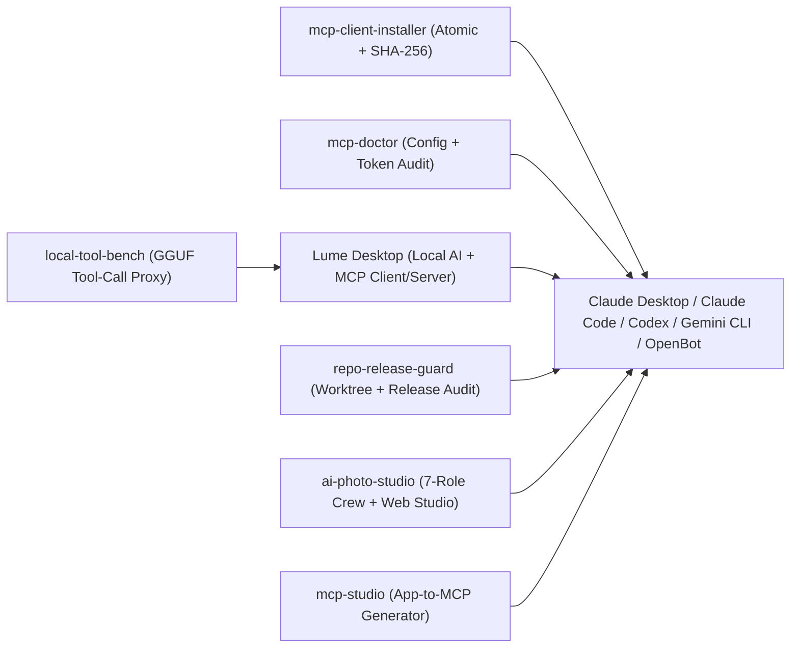

# Emerson Almeida (`@deusbr`)

**Full Stack & Local AI Engineer** — Building privacy-first desktop assistants, **Model Context Protocol (MCP)** developer tooling, and reproducible local LLM workflows from Brazil.

---

## Focus Areas

- **Model Context Protocol (MCP) Tooling:** Drift-safe client configuration installers, diagnostics, and stdio JSON-RPC 2.0 servers for **Claude Desktop**, **Claude Code**, **Cursor**, **Codex**, and **OpenBot**.
- **Local & Privacy-First AI:** Desktop inference with `llama.cpp` (CPU/Vulkan GGUF), local `Whisper` transcription, SQLite per-profile memory, and Ed25519-verified releases.
- **Full Stack & Automation:** Node.js, TypeScript, Electron, Python/FastAPI, and industrial/developer workflow automation.

---

## Featured Open-Source Projects

| Project | Role | Stack | License |
| :--- | :--- | :--- | :--- |
| [**lume**](https://github.com/deusbr/lume) | Open-source Windows desktop AI assistant with bidirectional MCP, local Whisper & `llama.cpp` | Electron, Node.js 24, MCP, SQLite | MIT |
| [**mcp-client-installer**](https://github.com/deusbr/mcp-client-installer) | Zero-dependency, SHA-256 drift-safe atomic MCP config installer & rollback library | Node.js, JSON/TOML, SHA-256 | MIT |
| [**mcp-doctor**](https://github.com/deusbr/mcp-doctor) | CLI & AI Skill to audit MCP configs, Windows wrappers, stdio handshakes, and token bloat | Node.js, MCP stdio, SKILL.md | MIT |
| [**local-tool-bench**](https://github.com/deusbr/local-tool-bench) | Tool-calling benchmark suite & JSON schema repair micro-proxy for local GGUF/Ollama models | Node.js, MCP, llama.cpp/Ollama | MIT |
| [**repo-release-guard**](https://github.com/deusbr/repo-release-guard) | Portable AI Skill + stdio MCP server for `git worktree` task isolation & pre-release hygiene audits | Node.js, Git, MCP, SKILL.md | MIT |
| [**ai-photo-studio**](https://github.com/deusbr/ai-photo-studio) | 7-role AI photo editing studio (Skill + MCP + Local Web UI) for Codex, Gemini CLI & Claude | Node.js, MCP stdio, SKILL.md, HTTP | MIT |
| [**mcp-studio**](https://github.com/deusbr/mcp-studio) | Zero-dependency MCP generator & workbench turning OpenAPI, CLIs, and Windows apps into MCP servers | Node.js, MCP stdio, OpenAPI, COM | MIT |

---

## Tech Stack

- **Languages & Runtimes:** JavaScript (Node.js 24), TypeScript, Python
- **AI & Protocols:** Model Context Protocol (`@modelcontextprotocol/client`, stdio JSON-RPC 2.0), `llama.cpp` (GGUF), Whisper, Agent Skills (`SKILL.md`)
- **Apps & Data:** Electron, React, FastAPI, SQLite, PostgreSQL, Playwright, GitHub Actions CI

---

## GitHub Stats

  
  

---

- GitHub: [github.com/deusbr](https://github.com/deusbr)
