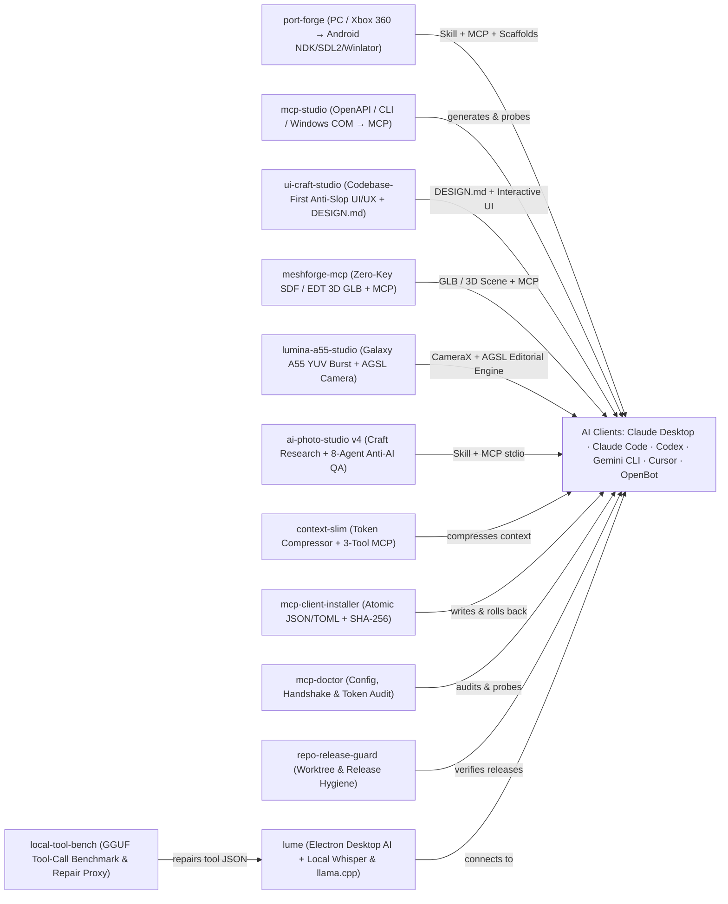

# Emerson Almeida (`@deusbr`)

### Full Stack & Local AI Engineer · Model Context Protocol (MCP) Tooling · Brazil

*Designing zero-dependency developer tooling, privacy-first desktop AI systems, and cross-client **Model Context Protocol (MCP)** infrastructure.*

[Focus Areas](#-focus-areas) · [Flagship Suite](#-flagship-open-source-suite) · [Ecosystem Architecture](#-ecosystem-architecture) · [Engineering Standards](#-engineering-standards) · [Tech Stack](#-tech-stack) · [GitHub Analytics](#-github-analytics)

---

## Focus Areas

<table>
  <tr>
    <td width="33%" valign="top">
      <h3>MCP Tooling &amp; Infrastructure</h3>
      
Zero-dependency generators, drift-safe SHA-256 config installers, handshake diagnostics, and <code>stdio</code> JSON-RPC 2.0 servers compatible with <strong>Claude Desktop</strong>, <strong>Claude Code</strong>, <strong>Codex</strong>, <strong>Gemini CLI</strong>, <strong>Cursor</strong>, and <strong>OpenBot</strong>.

    </td>
    <td width="33%" valign="top">
      <h3>Local &amp; Privacy-First AI</h3>
      
Offline-capable desktop inference with <code>llama.cpp</code> (CPU/Vulkan GGUF), local <code>Whisper</code> transcription, JSON Schema repair proxies for small models, SQLite memory, and Ed25519-signed releases.

    </td>
    <td width="33%" valign="top">
      <h3>Full Stack, Porting &amp; Agentic Studios</h3>
      
End-to-end developer workbenches combining portable <code>SKILL.md</code> workflows, native MCP servers, local web UIs, and PC/Xbox-to-Android porting automation (<code>NDK</code>, <code>SDL2</code>, <code>Winlator</code>) in Node.js, TypeScript, and Python.

    </td>
  </tr>
</table>

---

## Flagship Open-Source Suite

### AI Studios & Desktop Assistants

| Project | Summary | Core Stack | CI & Release |
| :--- | :--- | :--- | :--- |
| [**`port-forge`**](https://github.com/deusbr/port-forge#readme) | Zero-dependency cross-platform porting studio (CLI + MCP Server + Web UI + `SKILL.md`) for PC apps, Windows `.exe` (`Winlator/Box64/DXVK`) & Xbox 360 `.xex` (`XenonRecomp`) to Android | `Node.js >=18` · `MCP stdio` · `NDK/SDL2` · `Winlator` · `MIT` |   |
| [**`mcp-studio`**](https://github.com/deusbr/mcp-studio#readme) | Zero-dependency workbench (CLI + MCP Server + Local Web UI + `SKILL.md`) turning OpenAPI specs, local CLIs, and Windows desktop apps without native MCP support into tested MCP servers | `Node.js >=18` · `MCP stdio` · `OpenAPI` · `COM` · `MIT` |   |
| [**`ui-craft-studio`**](https://github.com/deusbr/ui-craft-studio#readme) | Zero-dependency Anti-AI-Slop UI/UX & Interactive App Design Studio MCP (Mobile + Desktop/PC): scans your codebase first, researches GitHub design skills, compiles `DESIGN.md` + clickable 4-state prototypes & runs deterministic WCAG AA audits | `Node.js >=18` · `MCP stdio` · `DESIGN.md` · `WCAG AA` · `MIT` |   |
| [**`meshforge-mcp`**](https://github.com/deusbr/meshforge-mcp#readme) | Zero-dependency, zero-API-key Text/Image-to-3D CLI, pure-code SDF/Marching-Tetrahedra & 2D-EDT GLB generator, Three.js inspector, and 7-tool `stdio` MCP server | `Node.js >=18` · `GLB/glTF` · `SDF` · `MCP stdio` · `MIT` |   |
| [**`lumina-a55-studio`**](https://github.com/deusbr/lumina-a55-studio#readme) | Native Android computational-photography camera crafted for Galaxy A55 (`CameraX` + `Camera2` + Multi-Frame YUV HDR+ burst + offline ML Kit/TFLite + GPU `OKLab` Capture One `AGSL` shaders) | `Kotlin` · `Jetpack Compose` · `CameraX` · `AGSL` · `MIT` |   |
| [**`ai-photo-studio`**](https://github.com/deusbr/ai-photo-studio#readme) | 8-agent Essence-Driven AI photo studio (`v4`: hybrid craft research, posing geometry, cinema/trailer & beauty presets, optical filters, editorial makeup, 5 prompt engines & Anti-AI QA) | `Node.js >=18` · `MCP stdio` · `SKILL.md` · `HTTP` · `MIT` |   |
| [**`lume`**](https://github.com/deusbr/lume#readme) | Open-source Windows desktop AI assistant with bidirectional MCP (`@modelcontextprotocol/client`), local `Whisper` CPU transcription, `llama.cpp` GGUF inference, SQLite memory & Ed25519 updates | `Electron` · `Node.js 24` · `MCP` · `SQLite` · `MIT` |   |

### MCP Infrastructure, Diagnostics & Token Optimization

| Project | Summary | Core Stack | CI & Release |
| :--- | :--- | :--- | :--- |
| [**`context-slim`**](https://github.com/deusbr/context-slim#readme) | Zero-dependency universal token-saving compressor (CLI + ultra-lean 3-tool `stdio` MCP + `SKILL.md`) with hybrid `repomix`/`rtk` support for code, JSON, logs, CSV & directories | `Node.js >=18` · `MCP stdio` · `SKILL.md` · `MIT` |   |
| [**`mcp-doctor`**](https://github.com/deusbr/mcp-doctor#readme) | Zero-dependency CLI, library, and portable `SKILL.md` auditing MCP configs across 7 clients (Claude Desktop, Claude Code, Cursor, Codex, Gemini CLI, Antigravity & VS Code) for broken paths, Windows wrappers, secret leaks, live handshakes & token bloat | `Node.js >=18` · `MCP stdio` · `SKILL.md` · `MIT` |   |
| [**`mcp-client-installer`**](https://github.com/deusbr/mcp-client-installer#readme) | Zero-dependency, SHA-256 drift-safe atomic MCP config installer and rollback library for JSON and TOML MCP clients | `Node.js >=18` · `JSON/TOML` · `SHA-256` · `MIT` |   |
| [**`local-tool-bench`**](https://github.com/deusbr/local-tool-bench#readme) | Zero-dependency tool-calling benchmark suite and JSON Schema repair micro-proxy (`<think>`/`<tool_call>` recovery, recursive coercion & `/stats`) for local GGUF (`llama.cpp`) and Ollama models | `Node.js >=18` · `HTTP Proxy` · `llama.cpp` · `Ollama` · `MIT` |   |
| [**`repo-release-guard`**](https://github.com/deusbr/repo-release-guard#readme) | Portable AI Skill (`SKILL.md`) and zero-dependency `stdio` MCP server for `git worktree` inspection, pre-release hygiene audits, secret scanning & SemVer tag readiness | `Node.js >=18` · `Git` · `MCP stdio` · `SKILL.md` · `MIT` |   |

---

## Ecosystem Architecture

---

## Engineering Standards

- **Zero-Dependency Core Philosophy:** Core MCP servers, installers, diagnostics, and studios run on pure Node.js standard libraries (`node:fs`, `node:http`, `node:crypto`, `node:child_process`, `node:test`) to eliminate supply-chain bloat and startup overhead.
- **Cross-Platform CI Matrix:** Every flagship repository runs automated GitHub Actions verification across `ubuntu-latest`, `windows-latest`, and `macos-latest` on Node.js `18`, `20`, `22`, and `24`.
- **Safe Automation by Default:** Atomic file swaps with SHA-256 drift detection, `execFile` without shell interpolation (`shell: false`), strict secret hygiene checks prior to release, and portable `SKILL.md` specifications.

---

## Tech Stack

| Layer | Technologies |
| :--- | :--- |
| **Languages & Runtimes** | JavaScript (`Node.js 18–24`), TypeScript, Kotlin, Python |
| **AI & Agent Protocols** | Model Context Protocol (`stdio` JSON-RPC 2.0, `@modelcontextprotocol/client`), Agent Skills (`SKILL.md`), `llama.cpp` (GGUF), Ollama, `Whisper` |
| **Applications & Mobile** | Electron, React, Jetpack Compose (`CameraX` / `Camera2` / `AGSL`), Vite, FastAPI, SQLite, Supabase / PostgreSQL |
| **Porting & Native Targets** | Android NDK, CMake, SDL2, Vulkan / DXVK, Winlator / Box64, Capacitor, Buildozer |
| **Quality & Delivery** | `node:test`, JUnit + Gradle CI, GitHub Actions CI/CD, Playwright, SemVer Releases, MIT Licensing |

---

## GitHub Analytics

  
  

---

  <strong>Open to AI/MCP engineering collaborations, developer tooling work, and open-source contributions.</strong> 
  Based in Brazil (UTC-3) · Reach out via <a href="https://github.com/deusbr">GitHub (@deusbr)</a> or repository issues &amp; discussions.

